# Gespatiens

[](https://github.com/EloyLagar/gespatiens-2026/actions/workflows/ci.yml)
[](LICENSE)


[](https://eloylagar.github.io/gespatiens-2026/)
[](https://eloylagar.github.io/gespatiens-2026/backend-coverage/)
[](https://eloylagar.github.io/gespatiens-2026/frontend-coverage/)

Aplicación web para la gestión de una comunidad terapéutica de tratamiento de adicciones. Reúne en un solo sitio la
documentación diaria de los residentes: el diario del centro, las actividades y sus valoraciones, las intervenciones
de los tutores, los informes de media estancia y fin de programa, el cuadrante de turnos y los avisos del personal.

Es la reescritura completa del proyecto final del ciclo de Desarrollo de Aplicaciones Web (IES Serpis, 2023/24),
desarrollado originalmente en Laravel, con una arquitectura hexagonal y diseño guiado por el dominio.

**[Ver la demo en línea →](https://gespatiens-2026.vercel.app)** · [API (Swagger)](https://gespatiens-2026.vercel.app/swagger-ui.html) ·
[Decisiones de arquitectura](docs/adr/README.md) · [Declaración de accesibilidad](https://gespatiens-2026.vercel.app/accesibilidad)

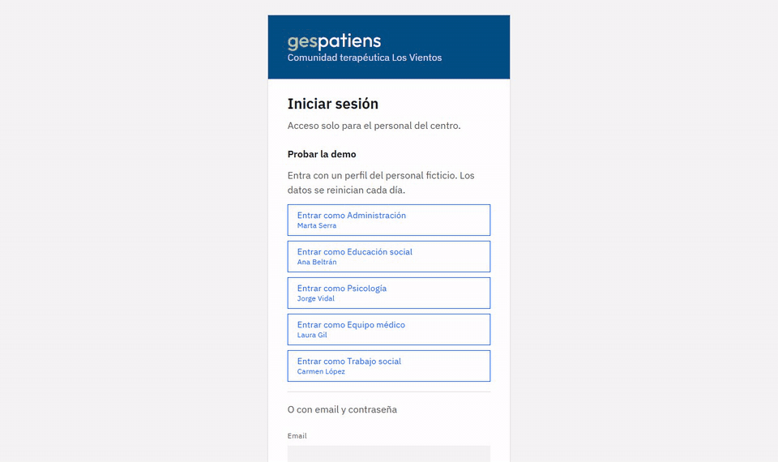

En la pantalla de entrada, los botones **Entrar como …** abren la demo con cada perfil sin escribir nada. También
se puede entrar con estas cuentas:

| Perfil | Email | Contraseña |
| --- | --- | --- |
| Administración | `marta.serra@vientos.es` | `demo1234` |
| Educación social | `ana.beltran@vientos.es` | `demo1234` |
| Psicología | `jorge.vidal@vientos.es` | `demo1234` |
| Equipo médico | `laura.gil@vientos.es` | `demo1234` |
| Trabajo social | `carmen.lopez@vientos.es` | `demo1234` |

Todos los datos son ficticios: diez residentes en el centro y tres antiguos, un mes de diario con valoraciones,
intervenciones, informes en distintas fases, avisos y dos meses de cuadrante. La demo pública se restablece cada día,
y el primer acceso puede tardar alrededor de un minuto si el servidor estaba en reposo: la pantalla de entrada lo
avisa.

## Capturas

| Diario del día | Informe de media estancia |
| --- | --- |
| 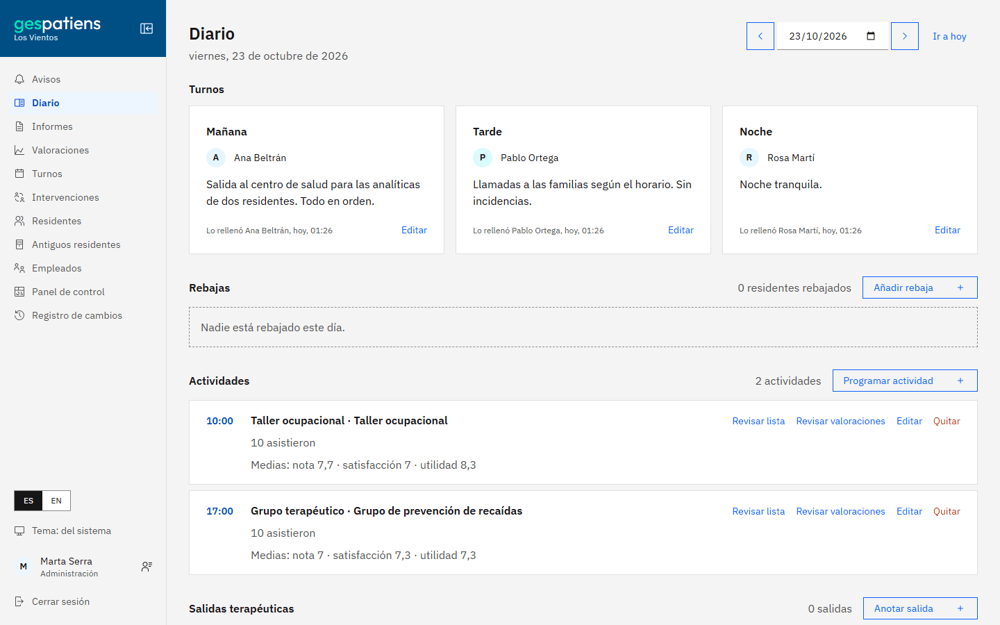 | 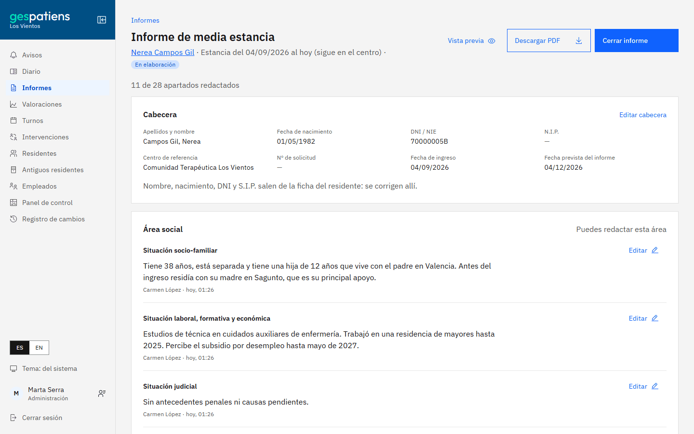 |
| **Valoraciones del mes** | **Cuadrante de turnos** |
| 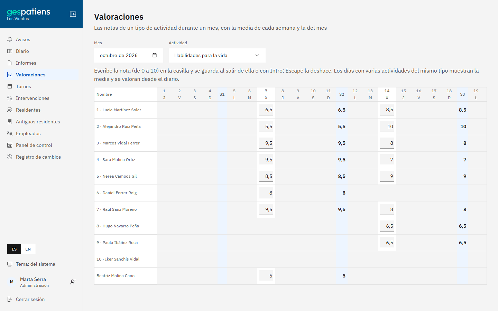 | 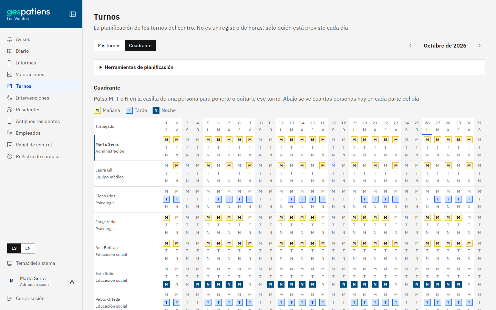 |
| **Panel de control** | **Tema oscuro** |
| 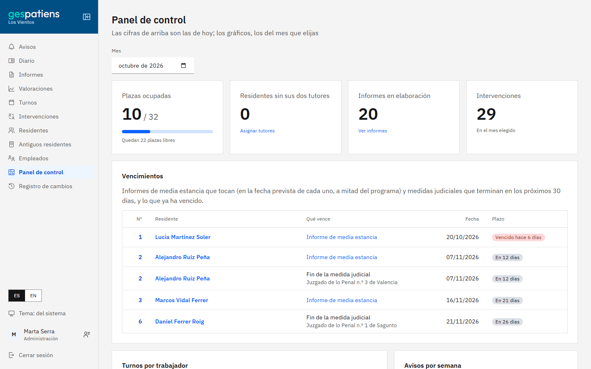 | 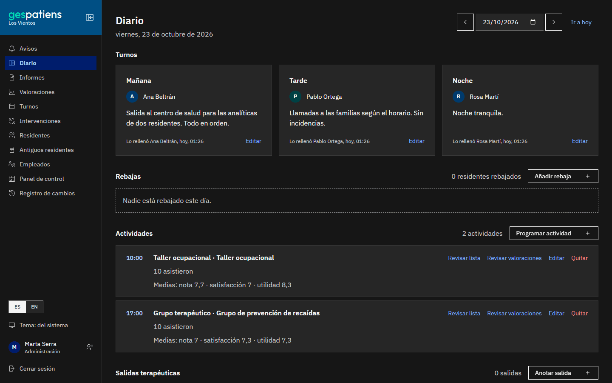 |

<p align="center">
  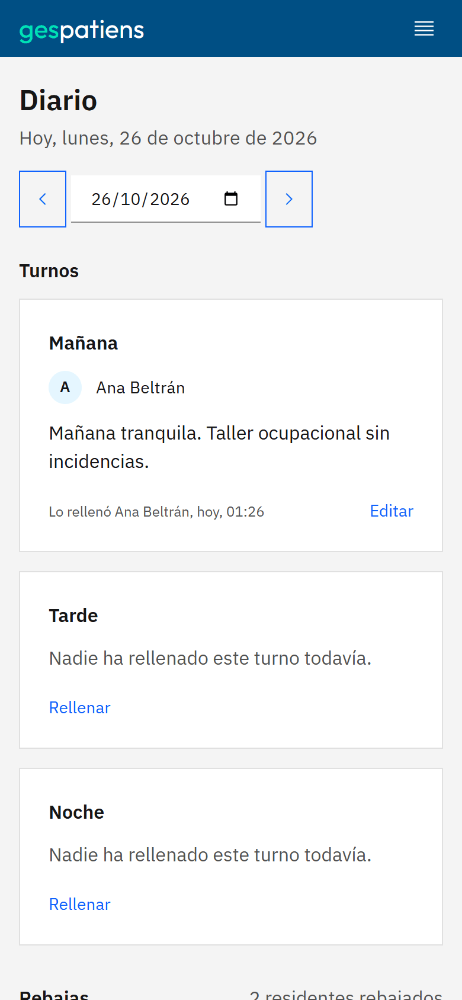
  &nbsp;
  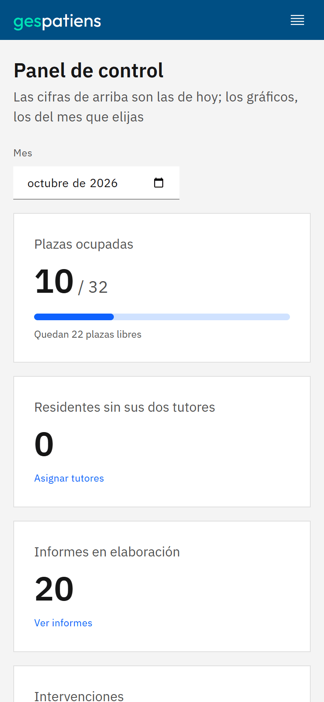
</p>

## Funcionalidades

- **Diario del centro**: turnos de mañana, tarde y noche, actividades programadas por día con su asistencia, salidas
  terapéuticas y reducciones de actividad.
- **Valoraciones**: notas de 0 a 10 por actividad y una vista mensual por tipo de actividad.
- **Intervenciones**: cada residente tiene dos tutores (educador y psicólogo), que son quienes registran sus
  intervenciones.
- **Informes**: el informe de media estancia y el de fin de programa se crean solos con cada estancia. Cada área
  redacta sus apartados, y el informe se firma y se exporta a PDF.
- **Residentes**: ingreso, reingreso, alta, historial de estancias, derivaciones y visitas autorizadas.
- **Cuadrante de turnos**: planificación del personal y cambios de turno entre compañeros.
- **Panel de control**: vencimientos cercanos de informes y de medidas judiciales.
- **Avisos**: canal de comunicación interno para todo el personal.
- **Permisos por especialidad**: cada empleado edita lo que le corresponde y consulta el resto.
- **Edición concurrente segura**: un documento abierto por otra persona queda bloqueado hasta que lo libera.
- **Registro de cambios**: quién modificó los datos de cada residente y cuándo, durante dos años.
- **Interfaz accesible (WCAG 2.1 AA) y bilingüe** (castellano e inglés), con tema claro, oscuro o el del sistema.
- **Tutorial de bienvenida** distinto para cada especialidad.

## Arquitectura

El backend está organizado en módulos por contexto delimitado: `access`, `patients`, `diary`, `interventions`,
`reports`, `rota`, `notices`, `dashboard`, `editing` y `audit`. Cada uno sigue la arquitectura hexagonal:

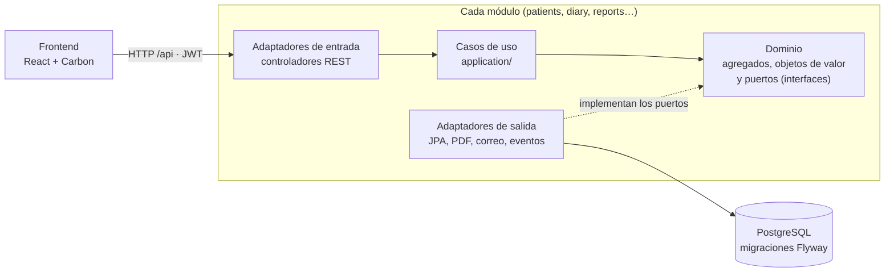

```
<módulo>/
├── domain/          Agregados, objetos de valor y puertos (interfaces de repositorio). Sin dependencias de Spring
├── application/     Casos de uso, sin anotaciones de Spring: se registran en infrastructure/config
└── infrastructure/  Adaptadores: controladores REST, persistencia JPA, seguridad y configuración
```

Los agregados se crean mediante métodos de fábrica que validan sus invariantes, y los identificadores se generan en
el dominio. Los módulos se avisan con eventos: al ingresar un residente, `patients` publica el inicio de la estancia
y `reports` crea sus informes sin que un módulo dependa del otro. El esquema de la base de datos se versiona con
migraciones de Flyway.

Por qué se tomó cada decisión, qué alternativas se descartaron y qué cuesta cada una:
**[docs/adr](docs/adr/README.md)**.

## Tecnologías

| Capa | Tecnologías |
| --- | --- |
| Backend | Java 25, Spring Boot 4, Spring Security (JWT), Spring Data JPA |
| Base de datos | PostgreSQL, Flyway |
| Frontend | React, TypeScript, Vite, Carbon Design System |
| Informes | OpenPDF |
| Pruebas | JUnit, Vitest, Playwright, axe, Lighthouse CI, JaCoCo |
| Documentación de la API | OpenAPI (springdoc) y Swagger UI |
| Infraestructura | Docker, GitHub Actions, Render, Vercel, Neon |

## Ejecución con Docker

Requisito: [Docker Desktop](https://www.docker.com/products/docker-desktop/).

```bash
docker compose up --build
```

Este comando arranca PostgreSQL, la API y el frontend, y carga los datos de demostración. La aplicación queda
disponible en http://localhost:8080 con las cuentas de la [demo](#demo).

El puerto, las contraseñas y el perfil se configuran copiando `.env.example` como `.env`. `docker compose down -v`
elimina los contenedores y los datos.

> [!WARNING]
> Los valores por defecto de `JWT_SECRET` y de la contraseña de la base de datos solo sirven para uso local.

## Desarrollo

Requisitos: JDK 25, Node.js 24 y PostgreSQL.

1. Crea una base de datos vacía `gespatiens-refactor`. Flyway crea las tablas al arrancar.
2. Define las variables de entorno:

   | Variable | Obligatoria | Descripción |
   | --- | --- | --- |
   | `DB_PASSWORD` | Sí | Contraseña de PostgreSQL (usuario `postgres` o el indicado en `DB_USER`) |
   | `JWT_SECRET` | Sí | Clave de firma de las sesiones, de al menos 32 caracteres |
   | `ADMIN_EMAIL`, `ADMIN_PHONE`, `ADMIN_PASSWORD` | Primer arranque | Crean el primer administrador |
   | `MAIL_HOST`, `MAIL_PORT`, `MAIL_USERNAME`, `MAIL_PASSWORD`, `MAIL_FROM` | No | Servidor SMTP para los correos de alta |
   | `FRONTEND_URL` | No | Destino de los enlaces de los correos (por defecto `http://localhost:5173`) |

3. Arranca la API en el puerto 8080:

   ```bash
   ./mvnw spring-boot:run
   ```

4. Arranca el frontend en el puerto 5173. Vite redirige `/api` a la API:

   ```bash
   cd frontend
   npm install
   npm run dev
   ```

Sin `MAIL_HOST` no se envían correos: el enlace de creación de contraseña de los nuevos empleados se escribe en el
log. Para probar los correos en local se puede usar [Mailpit](https://mailpit.axllent.org/).

## Pruebas

```bash
# Backend (las pruebas de persistencia usan PostgreSQL en un esquema propio, gespatiens_test)
./mvnw test

# Frontend
cd frontend
npm test
npm run typecheck

# Extremo a extremo, contra la aplicación levantada con docker compose
cd e2e
npm install
npx playwright install chromium
npx playwright test
```

La integración continua ejecuta las tres suites en cada push:

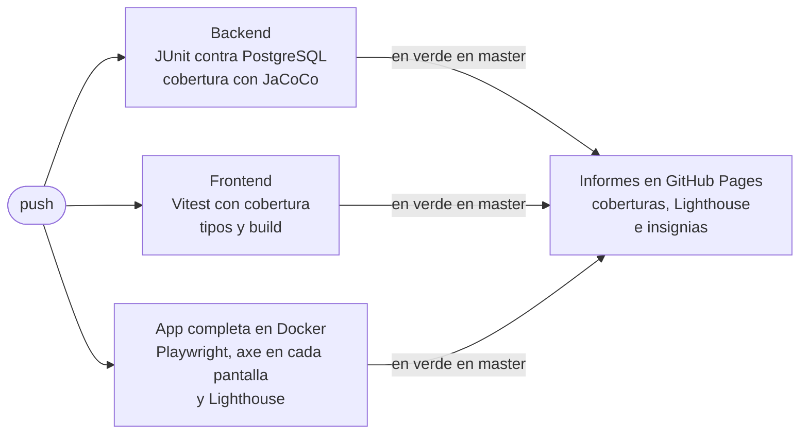

- **Accesibilidad automática**: axe revisa todas las pantallas con las reglas de WCAG 2.1 A y AA (y el tamaño
  mínimo de los botones de WCAG 2.2), en el tema claro, en el oscuro y en el móvil. Lighthouse exige 100 en
  accesibilidad en las páginas públicas. Lo que no se puede automatizar está en
  [docs/accesibilidad-revision-manual.md](docs/accesibilidad-revision-manual.md).
- **Cobertura**: el resumen de cada ejecución da el porcentaje de líneas cubiertas del backend y del frontend, y
  los informes completos se publican en [GitHub Pages](https://eloylagar.github.io/gespatiens-2026/).

## Despliegue

| Componente | Servicio | Configuración |
| --- | --- | --- |
| Frontend | Vercel | `frontend/vercel.json` |
| API | Render (Docker) | `render.yaml` |
| Base de datos | Neon (PostgreSQL) | Migraciones de Flyway |

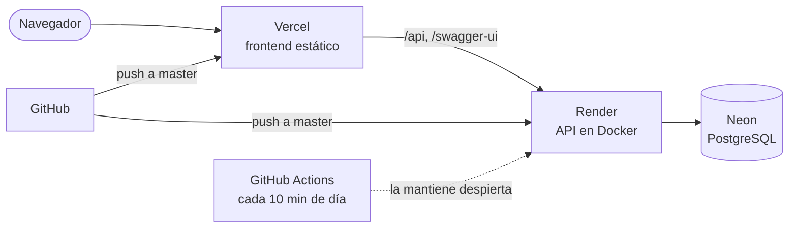

Vercel sirve el frontend y redirige `/api` a la API, de modo que la aplicación funciona en un único origen, sin
CORS. La API y la base de datos están en la misma región (Frankfurt). Con `DEMO_DAILY_RESET=true`, los datos de
demostración se restablecen cada día. El plan gratuito de Render duerme la API tras 15 minutos sin visitas, así que
un flujo programado (`.github/workflows/keep-awake.yml`) la avisa cada 10 minutos durante el día.

La documentación de la API está en `/swagger-ui.html` (en la demo,
[gespatiens-2026.vercel.app/swagger-ui.html](https://gespatiens-2026.vercel.app/swagger-ui.html)). Para probarla,
se entra con `POST /api/auth/login` y se pega el `accessToken` en **Authorize**. `API_DOCS=false` la desactiva.

## Seguridad

- Sesiones con JWT firmados por la API, sin estado en el servidor. En cada petición se comprueba que el empleado
  sigue existiendo y se toma su especialidad actual como rol.
- Permisos por especialidad en `SecurityConfig` y en el dominio (quién redacta cada apartado de un informe).
- Bloqueo de 15 minutos tras 5 intentos fallidos seguidos con el mismo email.
- Cabeceras de seguridad en Vercel y en el nginx de Docker: política de contenido estricta (solo recursos de la
  propia aplicación, sin estilos ni scripts en línea), `nosniff`, sin marcos, `Referrer-Policy` y
  `Permissions-Policy`. HSTS lo añade Vercel.
- Registro de cambios de los datos de los residentes (quién, qué y cuándo) durante dos años.

## Licencia

Distribuido bajo la licencia MIT. Consulta [LICENSE](LICENSE).

## Autor

**Eloy Lagar Jaime** · [GitHub](https://github.com/EloyLagar)

Gracias a Manuel Lagar Naharro por la idea original.
